<p align="center">
  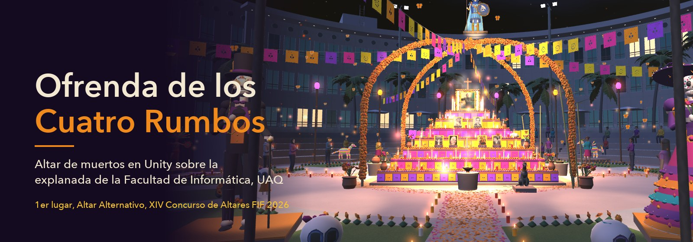
</p>

<p align="center">
  <a href="https://carlosquintana1.github.io/ofrenda-cuatro-rumbos/"><b>Página del proyecto</b></a> &nbsp;&nbsp;|&nbsp;&nbsp;
  <a href="https://carlosquintana1.github.io/ofrenda-cuatro-rumbos/jugar/"><b>Jugar en el navegador</b></a> &nbsp;&nbsp;|&nbsp;&nbsp;
  <a href="https://github.com/CarlosQuintana1/ofrenda-cuatro-rumbos/releases/latest"><b>Descargar para Windows y Mac</b></a> &nbsp;&nbsp;|&nbsp;&nbsp;
  <a href="https://carlosquintana1.github.io/ofrenda-cuatro-rumbos/ar/"><b>Verla en realidad aumentada</b></a>
</p>

<p align="center">
  
  
  
  
</p>

Una ofrenda de Día de Muertos de siete niveles, en el centro de la explanada de la Facultad de Informática de la UAQ (Campus Juriquilla), recreada en Unity. La hice con mi equipo **Puro BoxCollider** para el XIV Concurso de Altares y Ofrendas FIF 2026, donde ganamos el **primer lugar en la categoría Altar Alternativo**.

No es una ofrenda para ver en una pantalla: se recorre. Quien la visita la arma con cuatro rituales, lee el significado de cada elemento con su fuente y al final deja el nombre de alguien que recuerda.

<table>
  <tr>
    <td>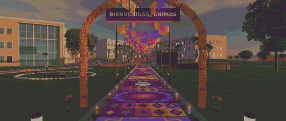</td>
    <td>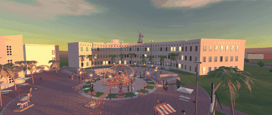</td>
  </tr>
  <tr>
    <td>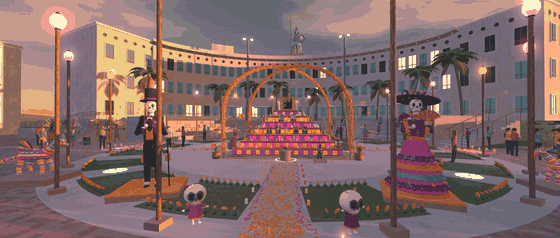</td>
    <td>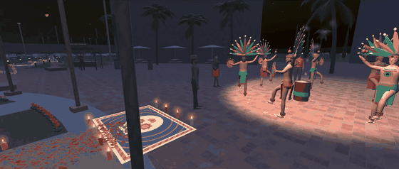</td>
  </tr>
</table>

## Contenido

- [Cómo jugarla](#cómo-jugarla)
- [La ofrenda](#la-ofrenda)
- [Controles](#controles)
- [Cómo la construí](#cómo-la-construí)
- [Galería](#galería)
- [Abrir el proyecto en Unity](#abrir-el-proyecto-en-unity)
- [Estructura del repositorio](#estructura-del-repositorio)
- [Créditos y fuentes](#créditos-y-fuentes)

## Cómo jugarla

| Dónde | Cómo |
|---|---|
| **Navegador** | Entra a [la versión web](https://carlosquintana1.github.io/ofrenda-cuatro-rumbos/jugar/). Funciona mejor en Chrome o Edge en computadora, con teclado y ratón. |
| **Windows** | Descarga `OfrendaCuatroRumbos-Windows.zip` de [Releases](https://github.com/CarlosQuintana1/ofrenda-cuatro-rumbos/releases/latest), descomprímelo y abre `Ofrenda de los Cuatro Rumbos.exe`. Si Windows dice "Windows protegió su PC", elige *Más información* y *Ejecutar de todas formas*: el ejecutable no está firmado. |
| **Mac** | Descarga `OfrendaCuatroRumbos-Mac.zip` de [Releases](https://github.com/CarlosQuintana1/ofrenda-cuatro-rumbos/releases/latest), descomprímelo y abre la app con clic derecho y *Abrir* la primera vez. |
| **Celular (realidad aumentada)** | Abre [la página AR](https://carlosquintana1.github.io/ofrenda-cuatro-rumbos/ar/) en el celular y toca el botón de realidad aumentada: la ofrenda aparece sobre tu mesa con la cámara, sin instalar nada. |

## La ofrenda

Cada cara de la pirámide mira a un rumbo y guarda un elemento. Al pie de cada cara hay un pedestal con anillo turquesa que activa su ritual:

| Rumbo | Elemento | Ritual |
|---|---|---|
| Norte | Fuego | Se encienden las veladoras de los siete niveles y el copal |
| Oriente | Agua | Se sirven los vasos de agua |
| Poniente | Tierra | Aparecen el pan de muerto, la fruta, el mole y los tamales |
| Sur | Viento | Se despliega el papel picado sobre la explanada |

Con cada ritual el cielo oscurece un paso. Con los cuatro ya es de noche: llegan las ánimas por el camino de cempasúchil y aparecen las mariposas monarca.

- **Siete niveles** con mantel morado, rosa y naranja, arco de cempasúchil, petate, sal, agua, cañas con golletes, calaveritas, cruz de ceniza y xoloitzcuintle.
- **26 retratos**: Juan Gabriel en lo más alto y 25 personas repartidas por tema en las cuatro caras (música, cine, televisión e historia y cultura), cada una con placa y ficha.
- **Cada elemento se puede señalar** para leer su significado en la tradición y la fuente de donde sale (INPI, Profeco, UNESCO y otras). Un contador lleva cuántos ha descubierto el visitante.
- **El papel picado** lleva cortadas en código binario ASCII las letras FIF y UAQ.
- **La plaza alrededor**: camino y tapetes de aserrín, mariachi de catrines, danzantes, alebrijes, La Catrina y El Catrín, puestos de pan y dulces, un campo de cempasúchil sembrado en forma de calavera y otro con el casco de los Troyanos.
- **Un catrín troyano** en el techo del edificio curvo, en memoria de los troyanos de la Facultad. Es el cierre del recorrido guiado.
- **Deja un nombre**: el visitante escribe el nombre de alguien que recuerda y se enciende una veladora con ese nombre, que se queda guardada.

## Controles

| | Teclado y ratón | Mando (Xbox, PlayStation o Switch) |
|---|---|---|
| Caminar | WASD | Stick izquierdo |
| Correr | Shift | LT o clic del stick |
| Mirar | Ratón | Stick derecho |
| Interactuar | E o clic | A |
| Atardecer, noche y día | N | Y |
| Recorrido guiado | | X (B para salir) |
| Reiniciar para el siguiente visitante | R | Start |
| Soltar el cursor | Esc | |

Si nadie toca nada durante 45 segundos, el recorrido guiado empieza solo y cualquier tecla devuelve el control. El proyecto también tiene OpenXR configurado para visores de realidad virtual, aunque no lo he probado en un visor físico.

## Cómo la construí

**La Facultad, a escala.** Tomé muchas fotos de la explanada, de los edificios, de las gradas, del letrero y de las jardineras, y saqué las medidas de la vista aérea de Google Maps usando su barra de escala (20 m = 6.85 px por metro). Con eso quedaron el medallón central (radio de 2.2 m), las isletas de pasto (de 6.8 a 9 m), las gradas (de 10.6 a 15 m), la explanada (radio de 19 m) y la fachada curva (radio de 21.5 m). La primera versión me salió 1.6 veces más grande porque calculé a ojo; la corregí empalmando la vista cenital de Unity sobre la foto satelital hasta que coincidieron. Después amplié solo el trazado horizontal 1.25 veces, porque con las medidas exactas el recorrido se sentía muy junto.

**Todo sale de código.** La escena no está armada a mano en el editor: la generan los scripts de `Assets/Editor` (`BuildFacultad.cs`, `BuildOfrenda.cs`, `BuildFiesta.cs`, `BuildDecoracion.cs` y `BuildMemoriaViva.cs`). Edificios, pirámide, comida, flores, papel picado, personajes y letreros en relieve son geometría generada por C#. Así cualquier medida se corrige y la escena se vuelve a generar en segundos.

**Artesanía mexicana como estilo.** Colores planos y una paleta cerrada de seis colores (cempasúchil, rosa mexicano, morado, amarillo, negro y hueso). Las figuras sencillas se leen como cartonería, que también es tradición. La primera versión tenía demasiado papel picado y colores fuera de la paleta, y la decoración competía con la ofrenda: le quité hasta que mandaron la comida, las velas y los retratos.

**Cada elemento justificado.** El concurso penalizaba los elementos sin justificar, así que cada significado lleva su fuente en pantalla. Lo que es interpretación popular está marcado como tal.

**Sonido.** Los efectos y la música del juego los generé por síntesis para este proyecto. La música del video es un vals original con instrumentos muestreados.

**Realidad aumentada.** Exporté una versión ligera de la ofrenda a GLB y la puse en una página web con model-viewer: en iPhone abre con AR Quick Look y en Android con Scene Viewer.

## Galería

<table>
  <tr>
    <td>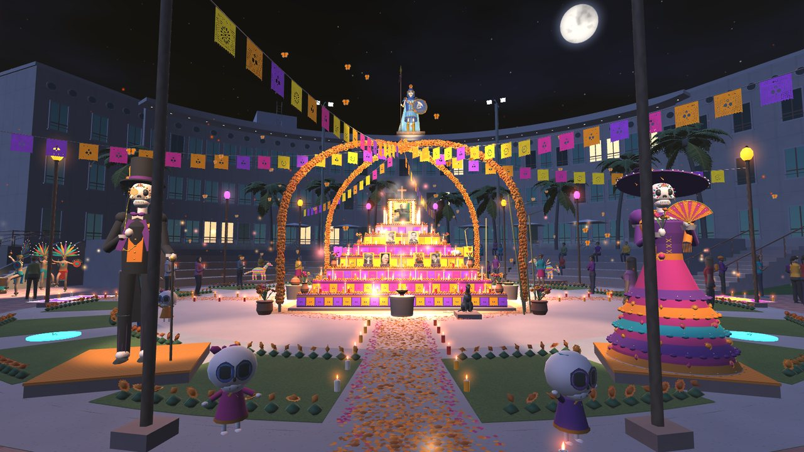</td>
    <td>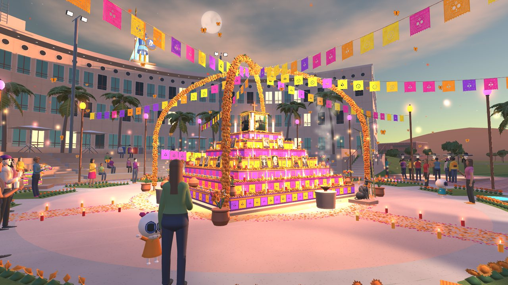</td>
  </tr>
  <tr>
    <td>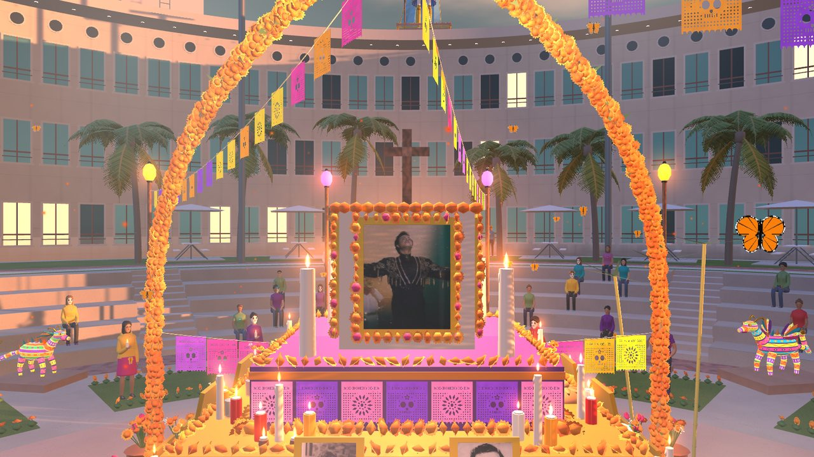</td>
    <td>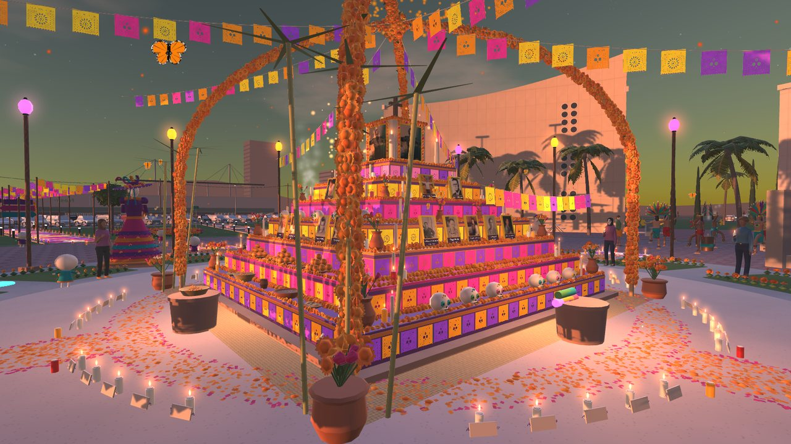</td>
  </tr>
  <tr>
    <td>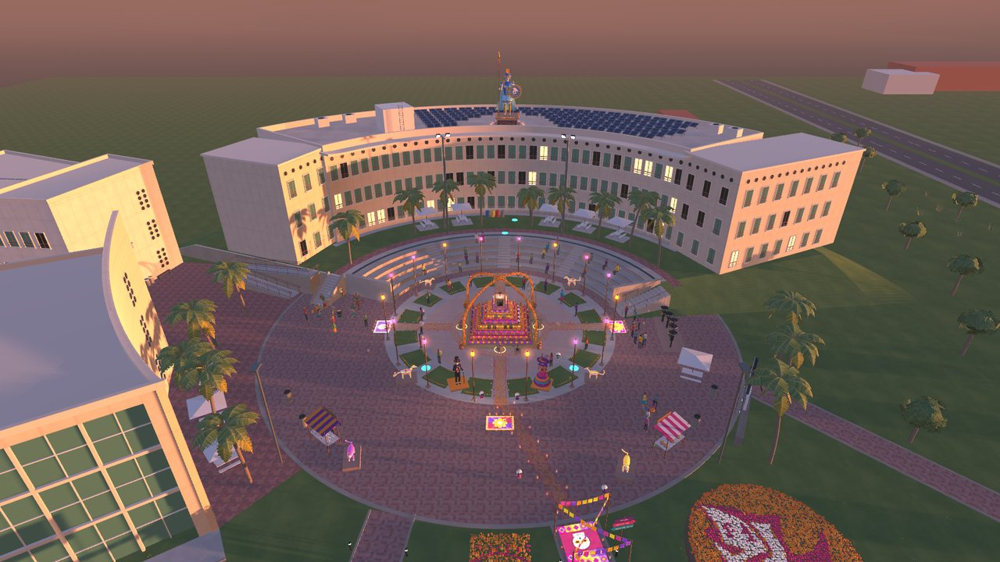</td>
    <td>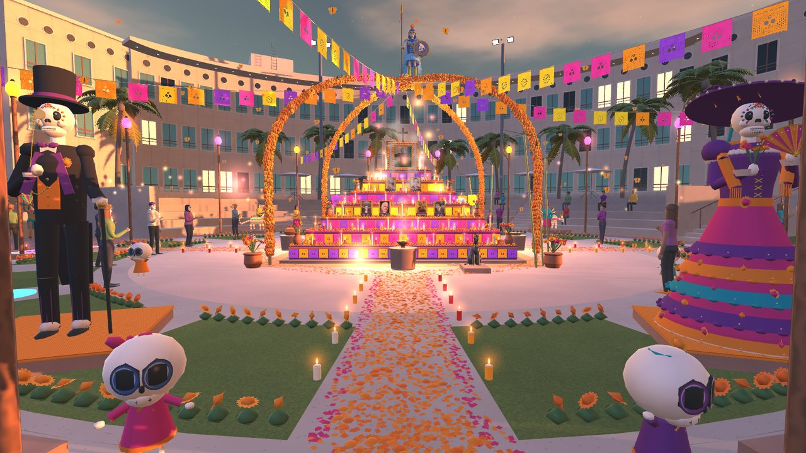</td>
  </tr>
  <tr>
    <td>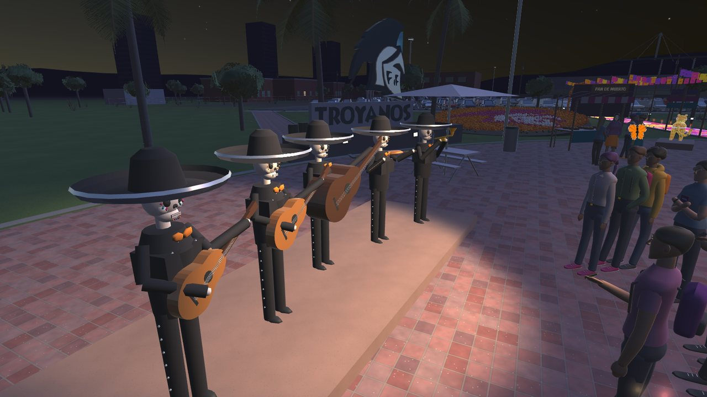</td>
    <td>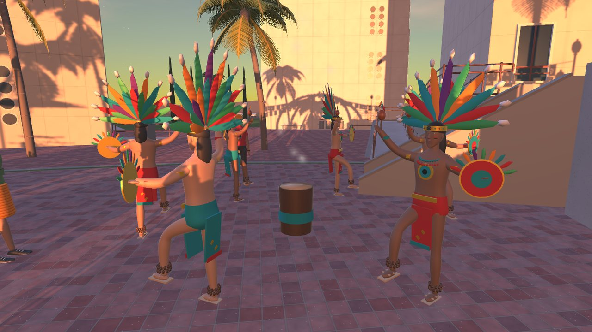</td>
  </tr>
  <tr>
    <td>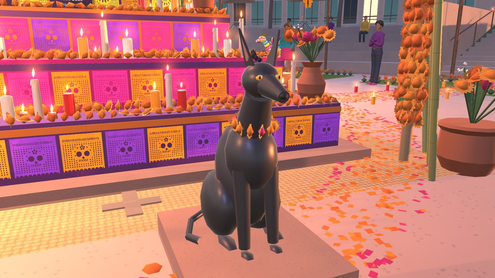</td>
    <td>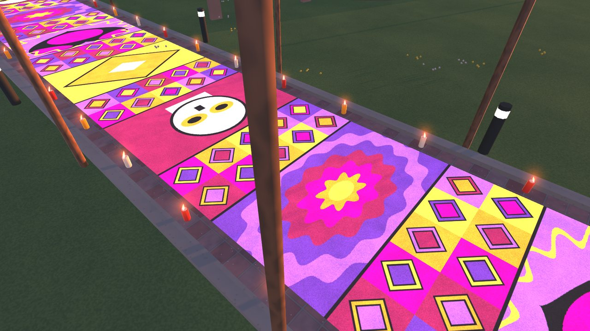</td>
  </tr>
  <tr>
    <td>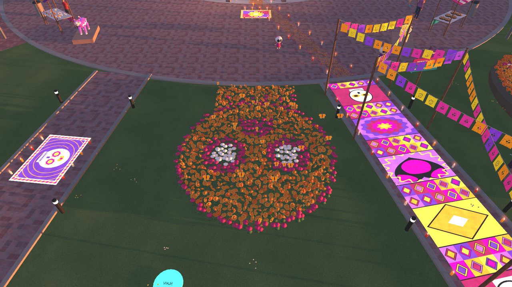</td>
    <td>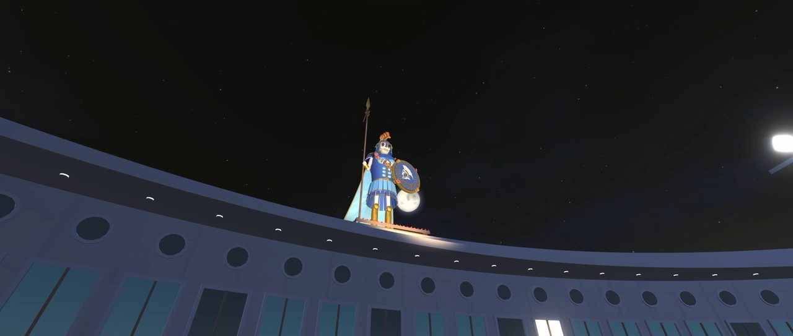</td>
  </tr>
</table>

## Abrir el proyecto en Unity

1. Instala **Unity 6000.5.6f1** desde Unity Hub. Tiene que ser esa versión.
2. Clona el repositorio o descárgalo como zip.
3. En Unity Hub elige **Add > Add project from disk** y selecciona la carpeta del repositorio. La primera vez tarda unos minutos mientras Unity genera la carpeta `Library`.
4. Abre `Assets/Scenes/MemoriaViva.unity` y dale **Play**.

Para generar los ejecutables usa el menú **Memoria Viva**:

| Menú | Qué genera |
|---|---|
| Construir ejecutable Windows | `Ejecutable/Windows/Ofrenda de los Cuatro Rumbos.exe` |
| Construir ejecutable Mac | `Ejecutable/Memoria Viva.app` |
| Construir version web | `Ejecutable/Web`, lista para subir a GitHub Pages |
| Reconstruir escena | Vuelve a generar la escena desde el código |

Cada plataforma necesita su módulo instalado en Unity Hub (Windows Build Support, Mac Build Support o WebGL Build Support). Ojo: **Reconstruir escena** reemplaza la escena completa, así que lo que se cambie a mano en el editor se pierde.

## Estructura del repositorio

```
Assets/
  Editor/        generadores de la escena, exportación AR y construcción de ejecutables
  Scripts/       lógica del juego: rituales, recorrido guiado, controles, sonido, ciclo de luz
  Shaders/       texto en relieve, brillo nocturno y estrellas
  Resources/     fotos de los retratos y sonidos
  MemoriaViva/   mallas y materiales generados
  Scenes/        la escena principal
docs/            página del proyecto (GitHub Pages), versión web y página AR
FUENTES.md       fuente de cada significado, foto y recurso
```

## Créditos y fuentes

Desarrollo: Carlos Quintana, con el equipo Puro BoxCollider. Facultad de Informática, Universidad Autónoma de Querétaro.

- Los significados vienen del INPI, Profeco, UNESCO y otras fuentes listadas una por una en [FUENTES.md](FUENTES.md).
- Las fotos de los retratos son de Wikimedia Commons, con su autor y licencia en [FUENTES.md](FUENTES.md). Los derechos de cada foto son de sus autores, no entran en la licencia MIT.
- Autos: "Car Kit" de [Kenney](https://kenney.nl), licencia CC0.
- Letras en relieve: DejaVu Sans Bold.

El código está bajo licencia [MIT](LICENSE).
